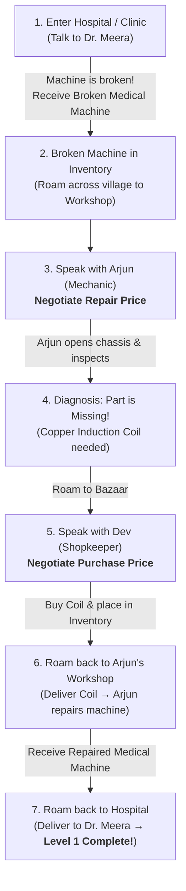

# AI-Powered Voice NPC Village Game --- Rough Project Plan

**Document:** `rough_project_plan.md`\
**Version:** 1.0\
**Date:** 4 November 2026\
**Project type:** 2D top-down village simulation with multilingual,
voice-enabled, autonomous AI NPCs

---

## 1. Project Overview

Build a playable 2D top-down village game in which the player can speak
naturally with individual NPCs and groups of NPCs. NPCs have distinct
personalities, memories, relationships, goals, and the ability to take
actions in the game world.

The key differentiator is **grounded autonomy**: NPCs must not merely
say that they will do something. They must request an allowed action,
have the game server validate it, and then visibly perform it in the
world.

### Core experience

- Explore a village using WASD movement while managing an active player inventory.
- Carry physical items, tools, and machinery in the backpack and roam across the world.
- Approach an NPC and start a natural voice or text conversation within a bounded threshold radius.
- Speak in supported Indian languages using Gnani AI speech services (or text fallback).
- Receive an NPC response powered by an LLM, bounded by character traits, role, and current state.
- Engage in real-time, dynamic price negotiations with merchants, craftsmen, and villagers.
- Give NPCs grounded commands such as follow, collect, repair, trade, or coordinate.
- Observe NPCs perform real, server-validated actions in the Phaser game world.
- Let NPCs converse with one another when the player is nearby.
- Have NPCs remember past events and adjust their emotional relationships and behavior.
- Progress through structured **story levels** specifically engineered to showcase all game features step-by-step (starting with Level 1: The Broken Clinic Machine quest).

### Product principles

1.  **Game first, AI second:** the game must remain playable if an AI
    provider is unavailable.
2.  **Server-authoritative world:** only the backend can commit
    world-state changes.
3.  **Actions must be real:** dialogue promises do not count as
    completed actions.
4.  **Contextual AI:** NPCs only receive relevant memories, nearby
    entities, and current world facts.
5.  **Cost-aware simulation:** do not call an LLM every frame or for
    routine movement.
6.  **Observable behavior:** the player should be able to see why an NPC
    is busy, moving, waiting, or acting.

---

## 2. Scope and Priorities

### P0 --- Required playable prototype

- [ ] Top-down village map and player movement with collision and sprint mechanics.
- [ ] Camera follows player; world scrolling and boundary limits.
- [ ] NPC sprites, directional animations, spawn points, and threshold interaction zones.
- [ ] Individual NPC voice & text dialogue powered by LLM (Groq/Gemini).
- [ ] Gnani AI STT and TTS integration with text input fallback.
- [ ] NPC profiles & database definitions: identity, personality, core goals, speaking style, voice settings.
- [ ] **Player Inventory System**: Grid/backpack storage, carrying items in hands/bag, weight limits, and world persistence while roaming.
- [ ] **Dynamic Price Negotiation Engine**: Interactive dialogue bargaining for service fees (Mechanic) and item purchases (Shopkeeper).
- [ ] **Grounded NPC Actions**: Visible server-validated actions (`inspect_machine`, `repair_machine`, `transfer_item`, `trade`).
- [ ] **Level 1 End-to-End Vertical Slice**: The complete 7-step Medical Machine Repair quest (Hospital broken machine → Mechanic negotiation → Missing part discovery → Shopkeeper purchase negotiation → Mechanic repair assembly → Hospital return & completion).
- [ ] Multi-step quest state tracker and objective HUD.

### P1 --- Main differentiators

- [ ] Level 2: The Granary Crisis (Companion following with Priya, farming/clearing with Ravi, multi-resource barter).
- [ ] Level 3: Shadows of Kaveripura (Day/night cycle, curfew patrol AI & interrogation with Inspector Vikram, stealth & lockpicking with Kalia).
- [ ] Level 4: The Banyan Council Deliberation (NPC-to-NPC proximity dialogue, 4-NPC group conversation with turn-taking under Ramesh Kaka).
- [ ] Level 5: The Resilient Village (Persistent Mem0 long-term memory, emergent consequences, multiple endings).
- [ ] NPC relationship scores and event-driven reputation changes.
- [ ] NPC daily schedules and autonomous waypoint routines.
- [ ] NPC command interface and action status indicator.

### P2 --- Stretch goals

- [ ] Dynamic asset generation.
- [ ] Complex multi-agent planning and delegation.
- [ ] Emergent village economy and complex social conflicts.
- [ ] Emotion-conditioned TTS, if Gnani exposes the required controls.
- [ ] Optional Jev AI integration after latency tests establish a
      concrete need.
- [ ] Advanced ambient conversations and persistent world simulation
      while the player is away.

**Scope rule:** Do not start P2 work until P0 is playable end-to-end.

---

## 3. Technology Stack

---

Area Choice Responsibility

---

Web application Next.js + React + Menus, HUD, dialogue,
TypeScript settings, quest journal

Game engine Phaser 3 Rendering, movement,
collision, animations,
scenes

Styling Tailwind CSS Web UI

Map editor Tiled Tilemaps, object
layers, spawn points,
collision layers

Pathfinding EasyStar.js Grid-based NPC
navigation

Frontend state Zustand UI state and selected
NPC/dialogue state

Realtime Socket.IO Game events, NPC state
updates, dialogue
events

Backend Node.js + TypeScript + Authoritative game
Express server and API

Database PostgreSQL Save games, NPC
profiles, memories,
relationships, world
state

ORM Drizzle Database schema and
migrations

LLM Google Gemini API Dialogue, intent
interpretation, bounded
planning

STT Gnani AI Speech-to-text

TTS Gnani AI Text-to-speech

Mem0 for npc memory with pgvector

Optional model provider Jev AI Only if benchmarked
latency/cost justifies
it

---

### Architecture decisions

- Start with a **modular monolith**: one Node.js backend with clear
  modules. Do not split into microservices for the prototype.
- Keep Gemini and Gnani API keys on the server. Never expose provider
  secrets in browser code.
- Use Socket.IO for realtime events and HTTP endpoints for operations
  that do not need realtime delivery.
- Use PostgreSQL as the durable source of truth. Zustand is only for
  client-side presentation state.
- Phaser owns rendering and local movement animation; the server owns
  authoritative NPC actions, inventory, quests, and world state.
- Do not use an LLM for frame-by-frame movement, collision, routine
  schedules, or deterministic game rules.

---

## 4. High-Level Architecture

```text
┌──────────────────────────────────────────────────────────┐
│                    Next.js Frontend                       │
│                                                          │
│  React HUD / Dialogue / Voice UI / Quest Journal         │
│                         │                                │
│                    Zustand Store                          │
│                         │                                │
│                    Phaser 3 Game                          │
│       Player · Map · NPCs · Collision · Animations       │
└─────────────────────────┬────────────────────────────────┘
                          │ Socket.IO + HTTP
┌─────────────────────────▼────────────────────────────────┐
│              Node.js + TypeScript Backend                 │
│                                                          │
│  Session Manager             Realtime Gateway             │
│  World Simulator             NPC Runtime                  │
│  Action Validator            Agent Orchestrator           │
│  Voice Gateway               Quest / Event Manager        │
│  Memory Manager              Provider Adapters            │
│                                                          │
└───────────────┬───────────────────────┬──────────────────┘
                │                       │
       ┌────────▼────────┐      ┌───────▼──────────┐
       │  PostgreSQL     │      │ External APIs    │
       │ Save / Memory   │      │ Gemini           │
       │ Relationships   │      │ Gnani STT / TTS  │
       │ Inventory       │      │ Optional Jev AI  │
       └─────────────────┘      └──────────────────┘
```

### Important runtime flow

1.  Player approaches an NPC and presses the interaction key.
2.  Frontend requests or opens an interaction session.
3.  Player audio is captured and sent to the backend.
4.  Backend sends audio to Gnani STT and receives recognized text.
5.  Backend builds a compact context: NPC profile, recent dialogue,
    relevant memories, relationship state, and nearby world facts.
6.  Gemini returns structured dialogue and, optionally, a proposed
    action.
7.  Backend validates the response against the action schema and game
    rules.
8.  Valid actions are placed in the NPC action queue and executed by the
    world simulator.
9.  Response text is sent to Gnani TTS.
10. Audio and dialogue events are sent to the frontend.
11. Important events are persisted as memories.

If any voice provider fails, show the recognized text/error and allow
text dialogue as a fallback.

---

## 5. Game World and Asset Integration

### Local asset directories

Use the supplied local assets. These paths are Windows development paths
and should be configured locally rather than hardcoded into application
code.

---

Game area / entity Asset directory

---

Village `C:\Users\kusha\Downloads\game_assets\Serene_Village_revamped_v1.9`

Main house exterior `C:\Users\kusha\Downloads\game_assets\Cute_Fantasy_Free`

Main house interior `C:\Users\kusha\Downloads\game_assets\home_rooms_interior`

Bedroom fallback `C:\Users\kusha\Downloads\game_assets\Pixel_16_interiors_v2_free`

Kitchen fallback `C:\Users\kusha\Downloads\game_assets\Kitchen and more tileset [16x16]`

Living room fallback `C:\Users\kusha\Downloads\game_assets\Top-Down_Retro_Interior`

Farm `C:\Users\kusha\Downloads\game_assets\Tiny Wonder Farm Free`

Hospital `C:\Users\kusha\Downloads\game_assets\topdown_hospital_Assets`

Shop `C:\Users\kusha\Downloads\game_assets\CozyShopInteriors-FREE-Demo-v1.1`

Mechanic workshop `C:\Users\kusha\Downloads\game_assets\azul`

---

### Character mapping

---

Character Asset

---

Main player `SuperRetroWorld_CharacterPack_Full/sprite_split/character_10`

Player's wife `SuperRetroWorld_CharacterPack_Full/sprite_split/character_12`

Doctor `RPG Top Down Character Asset Pack - FREE/RPG Top Down Characters - Free Version/Blue Haired Woman`

Shopkeeper `RPG Top Down Character Asset Pack - FREE/RPG Top Down Characters - Free Version/Blonde Man`

Mechanic `SuperRetroWorld_CharacterPack_Full/sprite_split/character_9`

Elder `SuperRetroWorld_CharacterPack_Full/sprite_split/character_4`

Farmer `SuperRetroWorld_CharacterPack_Full/sprite_split/character_14`

Other villagers Remaining suitable characters from `SuperRetroWorld_CharacterPack_Full/sprite_split`

---

### Asset integration checklist

- [ ] Inspect each asset pack's file structure and documentation.
- [ ] Confirm tile dimensions, sprite dimensions, animation frame
      layout, and transparency.
- [ ] Check license and attribution requirements for every pack.
- [ ] Standardize tile size and scale; avoid mixing assets with
      visibly incompatible pixel density.
- [ ] Create a central asset manifest with stable names.
- [ ] Slice/import character spritesheets and define idle/walk
      animations for all directions.
- [ ] Build a small test map before constructing the full village.
- [ ] Test house exterior/interior transitions.
- [ ] Use fallback interiors only if the preferred interior pack
      cannot be made visually consistent.

Do not assume that packs are automatically compatible just because they
are top-down assets. Verify tile size, perspective, palette, and license
first.

### Tiled map layers

Create the village map with layers such as:

- `Ground`
- `Ground_Details`
- `Buildings`
- `Above_Player`
- `Collision`
- `Interactables`
- `NPC_Spawns`
- `Pathfinding_Blockers`
- `Scene_Transitions`

Use Tiled object layers for named spawn points, doors, interaction
zones, and scene transitions. Export maps as JSON and load them in
Phaser.

---

## 6. NPC Design

### Initial NPC roster

---

| NPC ID | Name | Role | Personality | Level 1 & Core Story Function | Core Allowed Actions |
|---|---|---|---|---|---|
| `player` | Player | Village Resident | Player-controlled | Roam world, carry inventory items, speak, negotiate, deliver | `move`, `speak`, `inventory_carry`, `negotiate`, `trade` |
| `meera_doctor` | Dr. Meera | Clinic Doctor | Compassionate, clinical, urgent | **Level 1 Starter & Turn-in**: Identifies broken medical machine, tasks player, verifies repaired unit | `assign_machine_repair_quest`, `receive_repaired_machine`, `treat_injured`, `trade` |
| `arjun_mechanic` | Arjun | Master Mechanic | Intelligent, impatient, proud craftsman | **Level 1 Mechanic**: Negotiates repair fee, diagnoses missing Copper Induction Coil, fixes machine with part | `inspect_machine`, `negotiate_price`, `request_missing_part`, `repair_machine`, `transfer_item` |
| `dev_shopkeeper` | Dev | General Merchant | Shrewd, greedy, charismatic negotiator | **Level 1 Merchant**: Stocks missing Copper Induction Coil, engages in dynamic price bargaining | `negotiate_price`, `sell_item`, `buy_item`, `manage_stock`, `trade` |
| `priya_wife` | Priya | Companion & Caretaker | Warmhearted, witty, perceptive | **Level 2 Companion**: Provides survival counsel, assists with farm tasks, follows player | `follow_player`, `help`, `trade`, `provide_relief`, `converse` |
| `ravi_farmer` | Ravi | Veteran Farmer | Stubborn, hardworking, skeptical | **Level 2 Farmer**: Demands canal clearing assistance and fair barter before sharing granary food | `manage_farm`, `collect_resource`, `trade`, `barter_grain` |
| `vikram_police` | Inspector Vikram | Village Constable | Observant, disciplined, strict | **Level 3 Law Enforcer**: Enforces nighttime curfew, interrogates suspicious travelers, investigates thefts | `patrol`, `enforce_curfew`, `interrogate`, `protect_location` |
| `kalia_thief` | Kalia | Lock Specialist & Rogue | Elusive, streetwise, opportunistic | **Level 3 Rogue**: Picks locked disaster gates, scouts flooded ruins, fences black market items | `lockpick`, `scavenge`, `hide`, `trade_salvage` |
| `ramesh_elder` | Ramesh Kaka | Village Elder | Wise, patient, revered diplomat | **Level 4 Council Leader**: Presides over banyan tree panchayat, mediates village-wide supply debates | `preside_council`, `mediate_conflict`, `advise`, `bless` |
| `suresh_villager` | Suresh | Mason & Laborer | Humble, diligent, helpful | Background resident: clears masonry debris, repairs storm-hit roofs | `collect_resource`, `masonry_repair`, `help` |
| `maya_villager` | Maya | Artisan Weaver | Cheerful, expressive, optimistic | Background resident: weaves clinic bandages, sparks community conversations | `converse`, `assist`, `deliver_cloth` |

---

### NPC profile fields

Every NPC definition is anchored in the `npc_definitions` PostgreSQL database table:

```ts
type NPCProfile = {
  id: string;
  name: string;
  role: string;
  bio: string;
  personalityTraits: string[];
  speakingStyle: string;
  systemPrompt: string;
  coreGoals: string[];
  fears: string[];
  moralValues: string[];
  voiceProvider: string;
  voiceId: string;
  defaultLanguage: string;
  spriteKey: string;
  allowedActions: string[];
  homeZone: string;
  defaultSchedule: ScheduleEntry[];
  negotiationProfile: {
    basePriceModifier?: number;
    minPriceMultiplier?: number;
    patienceTurns?: number;
    greedLevel?: "low" | "medium" | "high";
    priceFlexibility?: "rigid" | "moderate" | "flexible";
    dislikedTactics?: string[];
    favoredArguments?: string[];
  };
  startingInventory: {
    itemId: string;
    name: string;
    quantity: number;
    basePrice?: number;
    category?: string;
    isQuestItem?: boolean;
    description?: string;
  }[];
};
```

Do not put all behavior into a giant system prompt. Keep identity,
current state, memories, goals, negotiation boundaries, and action permissions as separate structured data.

### NPC runtime state

```ts
type NPCState = {
  npcId: string;
  position: { x: number; y: number };
  activity: "idle" | "walking" | "talking" | "working" | "following" | "acting";
  currentGoal?: string;
  currentTaskId?: string;
  inventory: Record<string, number>;
  health?: number;
  energy?: number;
  relationshipToPlayer: number;
  nearbyNpcIds: string[];
  activeNegotiationSession?: {
    counterOffer: number;
    turnsRemaining: number;
    status: "in_progress" | "agreed" | "rejected";
  };
};
```
  npcId: string;
  position: { x: number; y: number };
  activity: "idle" | "walking" | "talking" | "working" | "following" | "acting";
  currentGoal?: string;
  currentTaskId?: string;
  inventory: Record<string, number>;
  health?: number;
  energy?: number;
  relationshipToPlayer: number;
  nearbyNpcIds: string[];
};
```

---

## 7. NPC Intelligence and Agent Design

### Use one LLM, not one LLM per NPC

All NPCs can share the same Gemini model/API. Each NPC gets a different
profile and context. This keeps the architecture simpler and avoids
multiplying model costs.

The NPC runtime should decide **when** an LLM call is justified. The LLM
should decide **what to say or propose**, not directly mutate the game
world.

### NPC decision cycle

```text
Observe
  ↓
Check local state and goals
  ↓
Is a decision required?
  ├── No → Continue deterministic behavior
  └── Yes
       ↓
Build compact context
       ↓
Call Gemini
       ↓
Parse structured result
       ↓
Validate against NPC permissions and world rules
       ↓
Queue approved action
       ↓
Execute action in world simulator
       ↓
Emit event and update memory
```

### Structured model output

Require JSON matching a schema. Example:

```json
{
  "dialogue": "The hospital needs food. I can spare ten units.",
  "emotion": "concerned",
  "intent": "offer_trade",
  "proposed_actions": [
    {
      "type": "trade",
      "target": "player",
      "items_given": { "food": 10 },
      "items_requested": { "medicine": 2 }
    }
  ],
  "memory_candidates": [
    {
      "content": "The player asked for food for the hospital.",
      "importance": 0.7
    }
  ]
}
```

The backend must validate every field. A model response is untrusted
input, even when it is valid JSON.

### Action system

Implement a strict action registry. Suggested initial actions:

---

Action Required parameters Server-side validation

---

`move_to` destination Destination exists and
is reachable

`follow_player` player ID, distance NPC is allowed to
follow

`collect_resource` resource, quantity, Resource exists;
source capacity and stock
allow it

`protect_location` location ID NPC can reach and guard
the location

`trade` target, offered items, Ownership, stock,
requested items quantity, and trade
rules

`talk_to_npc` target NPC ID, topic NPC is nearby and
available

`coordinate` target NPCs, task Participants exist and
can perform task

---

For the first prototype, implement `move_to`, `follow_player`,
`collect_resource`, and `trade` before the rest.

### NPC autonomy levels

1.  **Reactive:** responds to player interactions.
2.  **Goal-directed:** chooses from a small set of goals.
3.  **Collaborative:** asks nearby NPCs for help.
4.  **Autonomous:** executes scheduled goals and responds to world
    events.

Implement these levels in order. Do not let autonomous agents create
arbitrary tasks or bypass world rules.

---

## 8. NPC-to-NPC and Group Conversations

### Proximity-triggered conversation

NPC-to-NPC dialogue should not continuously call the LLM.

Use a proximity and relevance gate:

1.  NPCs are within a configured distance.
2.  Both NPCs are eligible to talk (not busy, in a cutscene, or already
    in another conversation).
3.  A conversation trigger exists: shared task, recent event,
    relationship, conflict, or social schedule.
4.  The player is within an audio/visibility radius if the conversation
    is intended to be heard.
5.  A cooldown prevents repeated conversation loops.
6.  Only then does the backend request dialogue from Gemini.

### Conversation state

```ts
type ConversationSession = {
  id: string;
  participantIds: string[];
  location: { x: number; y: number };
  topic: string;
  status: "active" | "paused" | "completed";
  currentSpeakerId?: string;
  startedAt: string;
  lastTurnAt: string;
};
```

### Group conversation flow

- The orchestrator selects a topic based on current events and
  participant goals.
- The LLM generates one speaker turn at a time, not a long
  uncontrolled transcript.
- The orchestrator selects the next speaker based on relevance,
  personality, and turn-taking rules.
- The session ends after a turn limit, topic resolution, participants
  leaving, or the player moving away.
- Important outcomes become world events and memory candidates.

**Cost optimization:** NPC movement, idle animations, proximity checks,
and routine schedules are deterministic code. Use LLM calls only for
meaningful conversational or planning decisions. Add per-NPC and
per-session cooldowns, token limits, caching where safe, and a maximum
number of simultaneous conversations.

---

## 9. NPC Memory and Relationships

### Memory types

---

Memory Example Storage

---

Working memory Current conversation Runtime/session
topic

Episodic memory Player brought medicine PostgreSQL
yesterday

Semantic memory The hospital is low on PostgreSQL/world facts
supplies

Relationship memory Player helped the Relationship/event
doctor records

---

### Memory lifecycle

1.  Capture important events, not every sentence.
2.  Convert them into compact memory candidates.
3.  Apply importance, recency, and relevance filters.
4.  Persist approved memories.
5.  Retrieve only relevant memories for the current interaction.
6.  Periodically summarize older memories to control context size.

### Suggested memory schema

```ts
type NPCMemory = {
  id: string;
  npcId: string;
  eventId?: string;
  content: string;
  memoryType: "episodic" | "semantic" | "relationship";
  importance: number;
  createdAt: string;
  lastAccessedAt?: string;
};
```

Start with PostgreSQL text and metadata search. Add vector embeddings
only if ordinary filtering and text search become insufficient. A vector
database is not a requirement for the first version.

### Relationship model

Store relationship values as structured dimensions rather than one vague
score:

- Trust
- Affection
- Respect
- Fear
- Resentment

Use bounded values, for example `-100` to `100`. Changes should be
caused by committed events, not arbitrary LLM output.

Example: completing a medicine delivery can increase the doctor's trust
in the player. Stealing from the shop can reduce the shopkeeper's trust
and trigger a police investigation.

---

## 10. Voice Interaction Design

### Individual voice interaction

```text
Player presses interaction key
       ↓
NPC interaction panel opens
       ↓
Player holds / taps microphone
       ↓
Audio captured in browser
       ↓
Backend → Gnani STT
       ↓
Recognized text
       ↓
Gemini dialogue + intent
       ↓
Action validation
       ↓
Gnani TTS
       ↓
Audio playback + NPC animation
```

### Voice requirements

- Support push-to-talk first. It is easier to control and debug than
  always-on listening.
- Provide a text-input fallback.
- Display recognized speech before or while processing, where API
  behavior allows.
- Handle silence, background noise, timeouts, retries, and provider
  errors.
- Keep audio payloads and recordings out of permanent storage unless
  there is a clear product requirement and consent.
- Verify Gnani's supported languages, audio formats, streaming
  support, voice selection, latency, quotas, pricing, and API
  authentication before finalizing the adapter.

### Emotion in TTS

Treat emotion as a presentation hint, not guaranteed functionality.
First check whether the Gnani TTS API supports emotion/style controls or
SSML-like controls for the selected voice. If it does not, use
punctuation and wording to influence delivery, and animate the NPC based
on the emotion label. Do not assume a bracketed instruction such as
`[Breathless and urgent...]` will be interpreted by the speech API.

### Provider adapter interfaces

```ts
interface SpeechToTextProvider {
  transcribe(input: AudioInput, options: STTOptions): Promise<Transcript>;
}

interface TextToSpeechProvider {
  synthesize(text: string, options: TTSOptions): Promise<AudioResult>;
}

interface LLMProvider {
  generateNPCResponse(input: NPCPromptInput): Promise<NPCResponse>;
}
```

This lets the project replace or supplement a provider without rewriting
game logic.

---

## 11. Story and Game Progression

The overarching narrative is structured as a **Level-Based Story Progression specifically engineered to showcase all game features and technical demos step-by-step**. Rather than abstract exposition, each level serves as an end-to-end playable demonstration of core systems: open-world roaming with physical inventory, voice/text dialogue, dynamic price negotiation, multi-step quest state progression, companion following, day/night stealth, and multi-agent group deliberation.

---

### Level 1 --- The Broken Heart of the Clinic (Core Loop & Negotiation Demo)

**Narrative Context:**
The village of Kaveripura is reeling from a catastrophic monsoon deluge. Lightning surges knocked out power grids, and low-lying homes were flooded. In the village hospital/clinic, Dr. Meera is overwhelmed with trauma patients. To make matters worse, the clinic's vital life-support machine (the oxygen concentrator and diagnostic centrifuge unit) has suffered electrical burnout and ceased functioning. Without it, critical patients cannot survive.

**Primary Demonstrations:**
1. WASD world navigation, collision detection, and interior transition.
2. Individual voice-to-voice and text NPC dialogue with Dr. Meera.
3. Dynamic quest assignment and server-validated item pickup into Player Inventory.
4. Player Inventory management and carrying items while freely roaming the open world.
5. Location discovery: finding Arjun's Mechanic Workshop.
6. **Price Negotiation Demo 1 (Mechanic):** Bargaining over repair service charges with Arjun using real-time dialogue and economic resistance curves.
7. Machine inspection, state diagnosis, and missing part discovery.
8. Location discovery: traveling across the central plaza to Dev's General Store.
9. **Price Negotiation Demo 2 (Shopkeeper):** Bargaining over purchase price of a scarce hardware component with Dev the greedy merchant.
10. Inventory persistence: purchasing, hauling, and delivering the missing component across the village.
11. Grounded NPC action execution: Arjun takes the part, runs repair animations and sound effects, and deposits the repaired machine into player inventory.
12. Quest completion: returning the functioning unit to Dr. Meera, receiving rewards, updating relationship scores, and completing Level 1.



#### Detailed Step-by-Step Level 1 Walkthrough

1. **Step 1: Hospital Consultation & Broken Machine Pickup**
   - **Action:** Player navigates to Dr. Meera's Clinic (x: 720, y: 240) and enters the door interior or talks to Dr. Meera within the 60px interaction radius.
   - **Dialogue:** Dr. Meera speaks urgently in Hindi/English: *"The storm power surges fried our primary oxygen concentrator! Patients with lung injuries can't breathe without it. Take this broken unit to Arjun's workshop on the eastern rim right now. But beware: Arjun is stubborn and charges for repairs—negotiate hard with him!"*
   - **System Event:** Server triggers quest `quest_level_1_machine_repair` (Objective 1: `deliver_machine_to_mechanic`).
   - **Inventory Event:** The `broken_medical_machine` item (weight: 6.5kg, category: `quest`, status: `broken`) is deposited into the player's inventory backpack. A held-item indicator shows on the player HUD.

2. **Step 2: Roaming with Item in Inventory**
   - **Action:** Player exits the clinic and walks/sprints across the village path eastward toward the workshop.
   - **Mechanic:** The player has a physical item in their inventory. Movement speed and animations reflect carrying equipment. The item persists seamlessly across zone transitions.
   - **System Event:** Player position updates via WebSocket (`player:move`). World collision prevents boundary exploits.

3. **Step 3: Mechanic Encounter & Price Negotiation (Negotiation Demo 1)**
   - **Action:** Player arrives at Arjun's Workshop (x: 1560, y: 240) and initiates dialogue.
   - **Dialogue:** Player explains the clinic emergency and asks Arjun to fix the machine.
   - **Mechanic Reaction:** Arjun inspects the unit and grunts: *"This is a specialized military-grade capacitor circuit. Normal repair fee is 120 silver rupees. Pay up front or find another mechanic."*
   - **Negotiation Interaction:** The player enters the Price Negotiation state. The player negotiates verbally or via text:
     - *Player:* *"Arjun, children in Meera's clinic are suffocating without oxygen! How can you charge 120 rupees during a flood?"*
     - *Arjun AI Evaluation:* The Dynamic Negotiation Engine processes the player's argument against Arjun's traits (`impatient`, `proud craftsman`, `moderate price flexibility`). Arjun softens: *"Alright, fine! For Dr. Meera and the patients, I'll drop my labor fee to 80 rupees. That's my final offer."*
     - *Agreement:* Deal is confirmed. 80 rupees/tokens are deducted from the player's wallet.

4. **Step 4: Machine Inspection & Missing Part Discovery**
   - **Action:** Arjun takes his wrench, unbolts the housing, and probes the circuitry.
   - **Discovery:** Arjun curses: *"Dammit! The central Copper Induction Coil didn't just blow—it melted into slag! I can't wind a new one without high-purity copper wire. I don't have that part in my scrap bin."*
   - **Instruction:** Arjun directs the player: *"Go to Dev's General Store in the central bazaar. That greedy merchant hoarders imported hardware. Tell him you need a 'Copper Induction Coil'. But watch your wallet—he'll smell your desperation and hike the price. Haggle him down!"*
   - **System Event:** Objective 1 marked complete. Objective 2 activated: `procure_copper_coil_from_dev`.

5. **Step 5: Bazaar Travel & Shopkeeper Price Negotiation (Negotiation Demo 2)**
   - **Action:** Player roams across the square to Dev's Store (x: 1120, y: 310) and engages Dev behind the counter.
   - **Dialogue & Asking Price:** Dev welcomes the player with merchant charm: *"Bhai re bhai! Welcome to Dev's Trading Post! Ah, you need a Copper Induction Coil? Genuine imported brass and copper! Extremely rare after the roads washed out. That will be 95 rupees."*
   - **Negotiation Interaction:** Player bargains with Dev (demonstrating merchant negotiation against high greed):
     - *Player:* *"95 rupees? That's daylight robbery! Ramesh Kaka will hear about this price gouging during an emergency!"*
     - *Dev Counter-Offer:* *"Arey boss, don't bring the elder into business! Supply and demand! But okay, for a neighbor in need, 75 rupees."*
     - *Player Counter:* *"55 rupees cash in hand right now, and I'll tell Dr. Meera you supported the clinic."*
     - *Dev Agreement:* *"Deal! You drive a hard bargain, friend. Take it before I change my mind!"*
   - **Inventory Event:** 55 rupees deducted. `copper_induction_coil` (category: `mechanical`, isQuestItem: `true`) added to player inventory.
   - **System Event:** Objective 2 complete. Objective 3 activated: `bring_coil_to_arjun`.

6. **Step 6: Return to Workshop & Grounded Repair Action**
   - **Action:** Player roams back to the workshop and delivers the Copper Induction Coil to Arjun.
   - **Grounded Action:** Arjun triggers action `repair_machine`:
     - Arjun animates working at his lathe/workbench.
     - Workshop hammering and electrical soldering audio cues play.
     - Server consumes `copper_induction_coil` from player inventory.
     - The machine state is updated from `broken` to `repaired`.
   - **Inventory Event:** Arjun deposits `repaired_medical_machine` into the player's inventory.
   - **Dialogue:** Arjun wipes his brow: *"There! Rewired, soldered, and humming like a dream. Now hurry back to the clinic before Meera loses another patient!"*
   - **System Event:** Objective 3 complete. Objective 4 activated: `deliver_repaired_machine_to_clinic`.

7. **Step 7: Return to Hospital & Level 1 Completion**
   - **Action:** Player roams back across Kaveripura to the clinic and delivers the repaired unit to Dr. Meera.
   - **Completion Interaction:** Dr. Meera inspects the humming machine, plugs it into the clinic battery, and exclaims with joy: *"The oxygen pressure is restored! You saved lives today. Take these clinic supplies and tokens as our gratitude."*
   - **Rewards:** +25 Relationship score with Dr. Meera, +5 Village Reputation, 100 XP, 3x Antiseptic Salves.
   - **System Event:** Quest `quest_level_1_machine_repair` status committed as `COMPLETED`. Level 1 complete banner displays on screen! Level 2 unlocks.

#### Features Demonstrated in Level 1

| Feature | Where it is Demonstrated in Level 1 |
|---|---|
| **Player Movement & Overworld Navigation** | Walking and sprinting across the village paths between clinic, workshop, and bazaar. |
| **Interior & Threshold Interaction** | Entering clinic, workshop, and store zones with dynamic talk threshold radius (<= 60px). |
| **Voice / Text STT & TTS Dialogue** | Speaking with Dr. Meera, Arjun, and Dev in Hindi/English with low-latency synthesis. |
| **Player Inventory System** | Storing, inspecting, carrying, and roaming with quest items (`broken_medical_machine`, `copper_induction_coil`, `repaired_medical_machine`). |
| **Dynamic Price Negotiation (Craftsman)** | Haggling with Arjun over repair labor fee; resistance curve based on patience and pride. |
| **Task Branching & Diagnosis** | Machine disassembly revealing missing spare part required to advance the quest. |
| **Dynamic Price Negotiation (Merchant)** | Haggling with Dev over scarce component; resistance curve based on merchant greed and market supply. |
| **Atomic Inventory Transactions** | Server-authoritative deduction of funds and addition/removal of physical item tokens. |
| **Grounded NPC Action Execution** | Arjun performing real repair animations and audio cues, mutating world/item state. |
| **Multi-Stage Quest State Machine** | Tracking 4 sequential objectives across multiple NPCs without LLM hallucination. |
| **Persistent Relationship Progression** | Relationship score with Dr. Meera increases; reputation points recorded in database. |

---

### Level 2 --- The Granary Crisis & The Farmer's Barter (Farming & Companion Demo)

**Narrative Context:**
With the clinic machine operational, food shortages threaten the village. Flood waters have ruined winter crops, and farmer Ravi refuses to open the communal granary without assistance and fair barter. The player must enlist their companion Priya to help.

**Demonstrated Features:**
- **Companion Following AI:** Priya follows the player, provides guidance, and comments on village dynamics.
- **Agricultural & Resource Gathering:** Clearing debris from flooded crop canals and harvesting carrots/grain at Ravi's farm.
- **Multi-Resource Barter:** Negotiating a composite trade (tools + labor for grain crates) instead of direct currency.
- **Inventory Weight & Encumbrance:** Hauling heavy grain sacks back to the village distribution center.
- **Emotional Memory:** Ravi recalls whether the player treated him with respect or tried to exploit him.

---

### Level 3 --- Shadows of Kaveripura & The Night Curfew (Day/Night & Stealth Demo)

**Narrative Context:**
As night falls over Kaveripura, Inspector Vikram enforces a village-wide curfew to prevent looting. However, vital antiseptic medicine is locked inside an abandoned, waterlogged dispensary behind a jammed iron gate. The player must either navigate police checkpoints or strike a deal with Kalia the thief.

**Demonstrated Features:**
- **Day/Night Cycle & Dynamic Lighting:** Visibility drops, lantern lighting activates, and NPC schedules transition to night routines.
- **Police Patrol AI & Interrogation:** Inspector Vikram walks patrol paths with vision cones; triggers curfew questioning if caught.
- **Rogue Mechanics & Lockpicking:** Kalia uses stealth in shadow alleys; offers lockpicking services in exchange for scavenged salvage.
- **Moral Choice & Consequence:** Choosing between lawful coordination with Vikram or illegal black-market lockpicking with Kalia.

---

### Level 4 --- The Banyan Council Deliberation (Multi-NPC Group Deliberation Demo)

**Narrative Context:**
A village-wide crisis reaches boiling point: Dev has acquired an emergency fuel shipment, but Dr. Meera needs it for clinic refrigeration, Ravi needs it for irrigation water pumps, and Dev wants to sell it to outside travelers. Ramesh Kaka convenes the village panchayat under the ancient banyan tree.

**Demonstrated Features:**
- **Proximity-Based NPC-to-NPC Conversations:** Villagers talk among themselves as the player approaches the plaza.
- **Group Conversation with Turn-Taking:** Ramesh Kaka moderates a formal 4-NPC debate (Meera, Ravi, Dev, Vikram) with structured speech turns.
- **Player Speech Intervention:** Player speaks into the microphone to propose a compromise; LLM scores persuasiveness across all NPCs.
- **Democratic Consensus Voting:** NPCs adjust their votes dynamically based on player arguments and relationship scores.

---

### Level 5 --- The Resilient Village (Persistent Simulation & Emergent Endings)

**Narrative Context:**
The floodwaters recede. The village reflects the cumulative consequences of the player's trade deals, council decisions, and relationship scores.

**Demonstrated Features:**
- **Mem0 Long-Term Episodic Recall:** NPCs reference specific promises, price negotiations, and debates from earlier levels.
- **Emergent World States:** Damaged buildings are either rebuilt or deserted based on resource distribution.
- **Branching Endings:** 
  - *The Communal Village:* High equality, functioning clinic, thriving farm.
  - *The Mercantile Outpost:* High wealth for Dev and Arjun, but strained social trust.
  - *The Fractured Haven:* Unresolved grudges and lingering shortages.

---

### Player Inventory & Roaming Architecture

To support roaming the world with physical items across all levels, the game features a server-authoritative **Player Inventory System**:

```ts
interface InventoryItem {
  id: string; // unique instance ID
  itemDefId: string; // e.g. "broken_medical_machine", "copper_induction_coil"
  name: string;
  category: "quest" | "mechanical" | "medical" | "resource" | "tool" | "currency";
  quantity: number;
  weight: number; // in kg
  condition: "broken" | "repaired" | "pristine" | "used";
  isQuestItem: boolean;
  iconSrc: string;
  description: string;
  customData?: Record<string, unknown>;
}

interface PlayerInventory {
  maxSlots: number; // e.g. 16 slots
  maxWeight: number; // e.g. 40.0 kg
  activeHeldItemSlot: number | null; // index of item held in player's hands
  items: (InventoryItem | null)[];
  tokens: number; // silver rupees/currency
}
```

#### Roaming Mechanics
- **World Persistence:** Items in the backpack persist across exterior village exploration and interior building transitions (hospital, workshop, store).
- **Visual Held-Item Indicator:** When carrying major quest items like the `broken_medical_machine` or `repaired_medical_machine`, the player sprite renders a visible carrying overlay or HUD item badge.
- **Movement Speed Integration:** Heavy quest loads apply realistic weight physics, slightly reducing sprint speed while roaming.
- **Atomic Server Validation:** Trades, item drops, and repairs run inside PostgreSQL transactions (`db.transaction`) to prevent inventory desynchronization or duplication.

---

### Dynamic Price Negotiation Engine

Price bargaining with NPCs like Arjun (repair fees) and Dev (item sales) is powered by a specialized **Dynamic Price Negotiation Engine**:

```mermaid
flowchart LR
    A["Player Spoken/Text Offer"] --> B["LLM Argument & Tone Evaluator"]
    B --> C["NPC Personality Filter<br/>(Patience, Greed, Flexibility)"]
    C --> D{"Within Bounds?<br/>(Floor ≤ Price ≤ Ceiling)"}
    D -->|Yes| E["NPC Proposes Counter-Offer or Accepts Deal"]
    D -->|No (Offensive / Ridiculous)| F["NPC Refuses / Loses Patience"]
    E --> G["Player Confirms → Atomic Wallet Deduction"]
```

#### Negotiation Parameters
- **Base Asking Price ($P_{\text{base}}$):** The initial price quoted by the NPC (e.g. 120 tokens for Arjun, 95 tokens for Dev).
- **Minimum Walk-Away Floor ($P_{\text{min}}$):** The absolute lowest price the NPC will accept regardless of persuasion ($P_{\text{base}} \times \text{minPriceMultiplier}$, e.g. 75 tokens for Arjun, 50 tokens for Dev).
- **Patience Counter ($N_{\text{patience}}$):** Number of negotiation rounds before the NPC grows exasperated and locks the current price.
- **Persuasion Factor:** Evaluates player arguments (urgent medical necessity, community goodwill, future barter promises, flattery).
- **Character Modifiers:**
  - *Dev (Shopkeeper):* High greed, loves banter, starts with +50% markup, gradually drops with charismatic haggling.
  - *Arjun (Mechanic):* Moderate greed, high pride, dislikes being called greedy, respects craftsmanship and emergency medical duty.

---

## 12. Database Design

### Initial PostgreSQL Tables

| Table | Purpose | Core Columns |
|---|---|---|
| `npc_definitions` | Master template containing immutable NPC traits, prompts, allowed actions, goals, and voices | `id`, `name`, `role`, `bio`, `personality_traits`, `speaking_style`, `system_prompt`, `core_goals`, `fears`, `moral_values`, `voice_provider`, `voice_id`, `default_language`, `sprite_key`, `allowed_actions`, `home_zone`, `default_schedule`, `negotiation_profile`, `starting_inventory` |
| `users` | Player accounts (NextAuth / email / credentials) | `id`, `email`, `name`, `created_at` |
| `game_sessions` | Active save slots and player session states | `id`, `user_id`, `current_level`, `village_reputation`, `playtime_seconds` |
| `world_states` | Village-level dynamic state and infrastructure health | `session_id`, `clinic_machine_status`, `generator_status`, `bridge_status`, `granary_level` |
| `npc_states` | Runtime position, activity, current goal, and coordinates | `session_id`, `npc_id`, `x`, `y`, `activity`, `current_zone`, `state` |
| `inventories` | Player and NPC inventory bags and coin balances | `id`, `session_id`, `owner_type` (player/npc), `owner_id`, `tokens_balance`, `max_weight`, `max_slots` |
| `inventory_items` | Specific item instances currently in inventories | `id`, `inventory_id`, `item_def_id`, `quantity`, `condition`, `is_quest_item`, `custom_data` |
| `items` | Master item definitions catalog | `id`, `name`, `category`, `weight`, `base_value`, `icon_key`, `description` |
| `quests` | Active and completed storyline quests | `id`, `session_id`, `quest_def_id`, `level_number`, `status` (active/completed), `created_at` |
| `quest_objectives` | Fine-grained objective tracking for quests | `id`, `quest_id`, `objective_key`, `order_index`, `status` (pending/completed), `completed_at` |
| `negotiation_sessions`| Active price bargaining sessions with NPCs | `id`, `session_id`, `npc_id`, `transaction_type` (service/purchase), `base_price`, `agreed_price`, `turns_taken`, `status` |
| `npc_memories` | Semantic and episodic memory entries (Mem0 + pgvector) | `id`, `npc_id`, `session_id`, `memory_type`, `content`, `embedding`, `emotional_valence` |
| `npc_relationships`| Multi-dimensional affinity scores between player & NPCs | `session_id`, `npc_id`, `trust_score`, `respect_score`, `friendship_score` |
| `world_events` | Immutable log of committed major story milestones | `id`, `session_id`, `event_type`, `payload`, `timestamp` |

### Data ownership

- The server writes world state, inventories, task results, and
  relationships.
- The LLM can propose memory candidates and actions but cannot write
  directly to tables.
- The frontend receives state updates and renders them.
- Use transactions for trades and resource transfers to prevent
  duplication or negative inventory.

---

## 13. API and Realtime Event Design

### HTTP endpoints

---

Method Endpoint Purpose

---

`GET` `/api/world/:sessionId` Load world snapshot

`GET` `/api/npcs` Get NPC definitions

`GET` `/api/npcs/:npcId` Get NPC profile/state

`POST` `/api/interactions` Start interaction

`POST` `/api/voice/transcribe` Transcribe player audio

`POST` `/api/voice/synthesize` Generate NPC audio

`POST` `/api/npcs/:npcId/command` Submit NPC command

`GET` `/api/quests` Get quest state

`POST` `/api/quests/:questId/objectives/:objectiveId/complete` Commit objective
completion

---

### Socket.IO events

Event Direction Purpose

---

`world:join` Client → Server Join game session
`world:snapshot` Server → Client Initial world state
`player:move` Client → Server Player movement input
`npc:state` Server → Client NPC state update
`npc:action_started` Server → Client NPC begins an action
`npc:action_completed` Server → Client NPC action result
`dialogue:started` Server → Client Dialogue begins
`dialogue:turn` Server → Client Dialogue message
`dialogue:ended` Server → Client Dialogue ends
`conversation:ambient` Server → Client Nearby NPC conversation
`quest:updated` Server → Client Quest progress update
`world:event` Server → Client Important world event

Use server-side validation, session authorization, payload limits, and
rate limits. Do not trust client-supplied NPC positions, inventory
changes, or action completion claims.

---

## 14. Frontend and Game UI

### Main game screen

- Phaser canvas occupies the main viewport.
- Player remains near the center while the camera follows.
- HUD shows health/energy only if those mechanics are implemented.
- Quest objective appears in a compact panel.
- Interaction prompt appears when the player is near an NPC or object.
- Dialogue panel shows NPC name, recognized player text, response
  text, and voice controls.
- Microphone button uses push-to-talk.
- Small activity indicators show nearby NPC states.

### Additional UI screens

1.  Main menu and save selection.
2.  Game settings: language, audio volume, microphone selection.
3.  Quest journal.
4.  NPC profile and relationship details.
5.  Inventory.
6.  NPC command panel.
7.  Optional debug panel for NPC state, action queues, and API latency.

### Phaser scenes

- `BootScene`: load essential configuration.
- `PreloadScene`: load maps, tilesets, and sprites.
- `MainMenuScene`: menu and save selection.
- `VillageScene`: main village map.
- `InteriorScene`: houses and buildings.
- `GameOverScene` or `EndingScene`: only if required by story design.

Use a shared game/session bridge to communicate between React and
Phaser. Avoid putting the entire Phaser runtime into Zustand.

---

## 15. Suggested Project Structure

```text
voice-npc-village/
├── apps/
│   ├── web/
│   │   ├── app/
│   │   ├── components/
│   │   │   ├── dialogue/
│   │   │   ├── hud/
│   │   │   ├── inventory/
│   │   │   ├── quests/
│   │   │   └── settings/
│   │   ├── game/
│   │   │   ├── scenes/
│   │   │   ├── entities/
│   │   │   ├── systems/
│   │   │   ├── maps/
│   │   │   └── animations/
│   │   ├── stores/
│   │   └── lib/
│   └── server/
│       ├── src/
│       │   ├── api/
│       │   ├── socket/
│       │   ├── game/
│       │   │   ├── world/
│       │   │   ├── movement/
│       │   │   ├── actions/
│       │   │   ├── inventory/
│       │   │   └── quests/
│       │   ├── npc/
│       │   │   ├── runtime/
│       │   │   ├── profiles/
│       │   │   ├── decisions/
│       │   │   ├── memory/
│       │   │   └── relationships/
│       │   ├── agents/
│       │   │   ├── orchestrator/
│       │   │   └── conversations/
│       │   ├── voice/
│       │   │   ├── providers/
│       │   │   └── pipeline/
│       │   ├── llm/
│       │   │   ├── providers/
│       │   │   ├── prompts/
│       │   │   └── schemas/
│       │   ├── db/
│       │   └── config/
│       └── Drizzle/
├── packages/
│   └── shared/
│       ├── types/
│       ├── events/
│       └── schemas/
├── assets/
│   ├── maps/
│   ├── tilesets/
│   ├── characters/
│   ├── buildings/
│   ├── audio/
│   └── manifest/
├── docs/
│   ├── architecture.md
│   ├── game-design.md
│   ├── npc-design.md
│   └── api-contracts.md
├── .env.example
├── package.json
└── README.md
```

Keep large source asset packs outside version control if licensing or
repository size makes that preferable. Include a script or documented
process to copy/import the approved assets into `assets/`.

---

## 16. Development Roadmap

A practical solo/small-team target is approximately **4--6 weeks for a
convincing prototype**, assuming API access and assets are ready. This
is an estimate, not a guarantee. Full polish and all advanced features
will take longer.

### Phase 0 --- Setup and technical verification

**Goal:** Remove integration unknowns before building the game.

- [ ] Create repository and workspace.
- [ ] Set up Next.js, TypeScript, Phaser, Tailwind, and backend.
- [ ] Set up PostgreSQL and Drizzle.
- [ ] Create `.env.example` and server-only secrets configuration.
- [ ] Test Gemini API with one structured JSON response.
- [ ] Test Gnani STT with a short audio sample.
- [ ] Test Gnani TTS with a response.
- [ ] Confirm supported languages, formats, streaming, limits, and
      pricing.
- [ ] Inspect asset licenses and technical compatibility.

**Deliverable:** Running app, backend, database, and verified provider
test scripts.

### Phase 1 --- Playable village foundation

**Goal:** A playable game without AI.

- [ ] Import village tileset and build a small map in Tiled.
- [ ] Load the Tiled JSON map in Phaser.
- [ ] Implement WASD player movement.
- [ ] Implement camera follow and world bounds.
- [ ] Implement collisions.
- [ ] Import main character spritesheet and directional animations.
- [ ] Add NPC spawn points and basic NPC sprites.
- [ ] Add interaction zones.
- [ ] Add house/interior transitions.
- [ ] Connect Phaser game state to React UI.

**Deliverable:** Player can explore the village, enter buildings, and
approach NPCs.

### Phase 2 --- NPC runtime and world actions

**Goal:** NPCs exist as game entities with executable behavior.

- [ ] Define NPC profiles and runtime state.
- [ ] Create server-side world state.
- [ ] Implement pathfinding with EasyStar.js.
- [ ] Implement NPC move-to behavior.
- [ ] Implement follow-player behavior.
- [ ] Implement resource nodes and inventories.
- [ ] Implement collect-resource behavior.
- [ ] Implement trade with transactional inventory updates.
- [ ] Add action queues, cancellation, and failure states.
- [ ] Broadcast NPC state/action events over Socket.IO.

**Deliverable:** NPCs visibly move, follow, collect, and trade without
using an LLM for movement.

### Phase 3 --- Individual AI and voice

**Goal:** Player can speak to an NPC and get a contextual response.

- [ ] Build Gemini provider adapter.
- [ ] Define structured NPC response schema.
- [ ] Build prompt/context assembler.
- [ ] Add NPC-specific personality and speaking style.
- [ ] Integrate Gnani STT.
- [ ] Integrate Gnani TTS.
- [ ] Implement push-to-talk UI.
- [ ] Add text fallback.
- [ ] Connect dialogue to NPC animations and activity states.
- [ ] Add timeout, retry, and provider-error handling.
- [ ] Add basic conversation persistence.

**Deliverable:** End-to-end multilingual voice interaction with at least
three distinct NPCs.

### Phase 4 --- Memory, relationships, and commands

**Goal:** NPCs remember important events and carry out player
instructions.

- [ ] Add memory and relationship tables.
- [ ] Implement memory candidate extraction and filtering.
- [ ] Retrieve relevant memories for dialogue.
- [ ] Implement relationship updates from committed events.
- [ ] Build command intent interpretation.
- [ ] Map commands to allowed action schemas.
- [ ] Validate actions against permissions and world rules.
- [ ] Show task progress and completion to player.

**Deliverable:** Player can ask an NPC to do something, the NPC
remembers relevant context, and the action occurs in the world.

### Phase 5 --- NPC collaboration and ambient conversations

**Goal:** Villagers interact with one another intelligently and
economically.

- [ ] Implement proximity detection.
- [ ] Add conversation eligibility and cooldowns.
- [ ] Add shared topic/event selection.
- [ ] Implement one-turn-at-a-time group dialogue.
- [ ] Add speaker selection and turn limits.
- [ ] Add player proximity/audio rules.
- [ ] Add NPC-to-NPC task requests and delegation.
- [ ] Persist important group outcomes.
- [ ] Add concurrency limits and cost metrics.

**Deliverable:** Two or more NPCs can talk and coordinate when the
player is nearby, without constant LLM calls.

### Phase 6 --- Story, Polish, and Feature Demonstration

**Goal:** Deliver a cohesive Level-Based playable experience that demonstrates every core system.

- [ ] Implement Level 1 objective state machine:
  1. Hospital consultation & `broken_medical_machine` inventory pickup.
  2. Roaming across Kaveripura to workshop with item in bag.
  3. Interactive price negotiation with Arjun the mechanic.
  4. Machine disassembly & `copper_induction_coil` missing part discovery.
  5. Roaming to bazaar & interactive price negotiation with Dev the shopkeeper.
  6. Return to workshop with coil; Arjun executes grounded repair; deposits `repaired_medical_machine`.
  7. Return to clinic & deliver working machine to Dr. Meera (Level 1 Complete).
- [ ] Implement Player Inventory UI modal and active HUD item holder.
- [ ] Implement Dynamic Price Negotiation UI and state engine for service fees and items.
- [ ] Implement Level 2 slice: Companion following with Priya, canal clearing, and granary barter with Ravi.
- [ ] Add sound effects, UI feedback, and transitions.
- [ ] Add save/load for world, inventory, and quest state.
- [ ] Test failure cases, network timeouts, and fallback modes.
- [ ] Prepare a repeatable 7-step Level 1 live demo script.

**Deliverable:** A polished, end-to-end playable Level 1 vertical slice demonstrating world roaming with inventory, voice interaction, two-stage dynamic price negotiations, grounded repair actions, and quest progression.

---

## 17. MVP Acceptance Criteria

The prototype is not complete just because APIs return responses. It
must pass observable end-to-end tests.

---

| Feature | Acceptance Test |
|---|---|
| **Movement & Boundaries** | Player moves in 4 directions, sprints with Shift, and cannot pass through blocked map tiles. |
| **Camera & Bounds** | Camera follows player smoothly and respects map bounds without tearing or shaking. |
| **Interaction Threshold** | NPC dialogue interaction begins only within the configured radius (<= 60px). |
| **Voice STT** | Spoken player audio produces accurate transcript in Hindi or English using Gnani STT. |
| **NPC Dialogue** | NPCs respond in character using bounded personality traits, core goals, and speaking style without plot hallucinations. |
| **Voice TTS** | NPC reply plays as natural voice audio using Gnani Timbre v2.5; text remains readable on HUD. |
| **Player Inventory System** | Player receives items into backpack, carries them while roaming across the village, and items persist across interior door transitions. |
| **Price Negotiation (Mechanic)** | Player negotiates repair service fee with Arjun; price dynamically adjusts within bounded min/max multiplier based on persuasion. |
| **Missing Part Quest Step** | Arjun examines machine, triggers missing part objective, and directs player to Dev. |
| **Price Negotiation (Merchant)** | Player bargains with Dev for the Copper Induction Coil; agreed transaction atomically deducts tokens and adds item. |
| **Grounded NPC Action Execution** | Arjun executes `repair_machine`, consumes the coil, plays workshop audio, and delivers `repaired_medical_machine`. |
| **Level 1 Completion** | Player hands repaired machine to Dr. Meera at clinic; quest completes, relationship score increases, and Level 1 banner renders. |
| **Follow / Companion** | Companion NPC navigates toward and follows player through the world. |
| **Fallback Mode** | Text interaction and UI fallback remain completely functional if microphone, STT, or TTS fails. |
| **Persistence** | Reloading session restores world state, inventory items, and quest objective progress. |

---

## 18. Cost, Latency, and Reliability Strategy

### Avoid unnecessary LLM calls

Do not call Gemini for: - Every game frame. - Every NPC movement step. -
Routine idle behavior. - Simple pathfinding. - Deterministic inventory
changes. - Every proximity check.

Use ordinary code for these operations.

### Use LLM calls for

- Player dialogue.
- Ambiguous command interpretation.
- Meaningful NPC decisions.
- Conversation turns.
- Complex task delegation.
- Memory summarization, when needed.

### Controls

- Proximity gates and cooldowns for ambient dialogue.
- Maximum group conversation turns.
- Maximum concurrent LLM and voice requests.
- Short context windows with relevant memory retrieval.
- Token and latency logging per provider call.
- Request timeouts and bounded retries.
- Idempotency keys for actions that mutate world state.
- Per-session rate limits.
- Caching for static NPC profile/system instructions where supported.

### Suggested telemetry

Record: - STT latency. - LLM latency. - TTS latency. - Total time from
end of player speech to start of NPC audio. - Token usage and estimated
cost. - Failed/invalid structured outputs. - Action success/failure
rate. - Number of ambient conversations per session.

Set performance targets only after measuring the actual APIs and
devices. Do not promise real-time voice behavior before testing the full
pipeline.

---

## 19. Security and Game Integrity

- Keep all provider API keys in backend environment variables.
- Validate all LLM output with runtime schemas.
- Treat dialogue and model output as untrusted.
- Use action allowlists and per-NPC capabilities.
- Validate NPC location, reachability, inventory, and task state on
  the server.
- Use database transactions for trades and resource changes.
- Prevent replayed commands from executing twice.
- Rate-limit voice and LLM endpoints.
- Authenticate and authorize game sessions if accounts/multiplayer are
  added.
- Avoid storing raw voice recordings unless necessary and clearly
  disclosed.
- Do not let an NPC command arbitrary URLs, code, shell commands, or
  database queries.

---

## 20. Testing Strategy

### Unit tests

- Action schema validation.
- Inventory and trade calculations.
- Relationship update rules.
- Memory selection and relevance filtering.
- Quest progression conditions.
- NPC state transitions.

### Integration tests

- Gemini adapter and malformed output handling.
- Gnani STT/TTS adapters.
- Socket.IO event contracts.
- Drizzle transactions.
- Action queue and world simulator.
- Save/load.

### Gameplay tests

- NPC blocked by obstacles.
- NPC target unreachable.
- NPC asked to collect unavailable resources.
- NPC asked to trade items it does not own.
- NPC conversation interrupted by player movement.
- Two conversations competing for the same NPC.
- API timeout while NPC is speaking.
- Player disconnects during an action.
- Duplicate action event received.
- Save/load during a multi-step quest.

---

## 21. Demo Script

A reliable 4--6 minute live demonstration that proves the core grounded simulation loop and showcases all Level 1 features end-to-end:

1. **Explore & Enter Clinic:**
   - Move through Kaveripura using WASD into Dr. Meera's Health Clinic.
   - Approach Dr. Meera (within the 60px proximity radius).
2. **Consultation & Broken Machine Pickup (Step 1):**
   - Speak via push-to-talk microphone (or text) to Dr. Meera.
   - Dr. Meera urgently explains the power surge burnout of the oxygen concentrator.
   - Player accepts quest; `broken_medical_machine` is placed into the Player Inventory.
3. **Roaming the World with Inventory (Step 2):**
   - Player leaves the clinic with the broken machine held in their inventory.
   - Roams across the village paths to the eastern rim to Arjun's Mechanic Workshop.
4. **Service Price Negotiation with Mechanic (Step 3):**
   - Approach Arjun at his workbench and request repair.
   - Arjun quotes 120 rupees; player negotiates down using voice ("Patients in the clinic need oxygen!").
   - Dynamic negotiation engine accepts counter-offer of 80 rupees; wallet deducts funds.
5. **Machine Disassembly & Missing Part Discovery (Step 4):**
   - Arjun unbolts the casing and diagnoses the fault: the central Copper Induction Coil has melted.
   - Arjun tasks player to buy a replacement coil from Dev's store in the bazaar.
6. **Merchant Price Negotiation at the Bazaar (Step 5):**
   - Player roams to the central plaza store and approaches Dev the shopkeeper.
   - Dev asks for an exorbitant 95 rupees; player negotiates aggressively down to 55 rupees.
   - Dev transfers `copper_induction_coil` into player inventory.
7. **Grounded Repair Action Execution (Step 6):**
   - Player carries the coil back to Arjun's workshop.
   - Arjun consumes the coil, plays workshop repair animations and sounds, and awards `repaired_medical_machine` into the player's inventory.
8. **Clinic Delivery & Level 1 Complete (Step 7):**
   - Player carries the repaired machine back to the hospital and delivers it to Dr. Meera.
   - Dr. Meera tests the machine, confirms oxygen restoration, awards reputation points, and triggers the **Level 1 Complete** victory banner.

Prepare a deterministic fallback path (mock STT/TTS and predefined dialogue steps) in case an external speech API experiences network latency during live demonstration.

---

## 22. Risks and Mitigations

---

Risk Mitigation

---

Gnani API language/voice feature Verify API capabilities with test
mismatch requests before building the voice
UI

Voice latency too high Measure each stage; use streaming
if supported; keep text fallback

LLM produces invalid actions Strict schemas, allowlists, server
validation

Token cost from NPC chatter Proximity gating, cooldowns, turn
limits, deterministic simulation

NPCs get stuck Pathfinding failure handling,
alternate destinations, task
timeout

Asset packs look inconsistent Audit dimensions, palette,
perspective, and scale before map
production

Scope becomes too large Prioritize P0 and one polished
story slice

AI provider outage Provider adapters, timeout
handling, text fallback

NPC memory grows without bound Importance filtering, retrieval,
summarization, retention policy

Duplicate trades/actions Idempotency keys and database
transactions

---

---

## 23. Immediate Next Steps

Start in this exact order:

1.  Create the repository and workspace.
2.  Inspect the downloaded asset folders and record tile/sprite
    dimensions and licenses.
3.  Build a tiny Tiled village test map with one house, one road, one
    collision layer, and three NPC spawn points.
4.  Load it in Phaser and implement player movement, camera, and
    collisions.
5.  Create the backend and PostgreSQL/Drizzle schema.
6.  Verify Gemini structured output with one NPC.
7.  Verify Gnani STT and TTS independently with real sample audio.
8.  Connect one NPC interaction end-to-end.
9.  Implement one real NPC action (`collect_resource`) and show its
    result in the world.
10. Only after that works, add memory, relationships, and NPC-to-NPC
    conversation.

### Definition of the first milestone

The first milestone is complete when the player can walk around a small
village, approach Ravi, speak to him, hear a personality-consistent
response, ask him to collect food, and watch him navigate to the farm
and update the inventory.

That single vertical slice validates the most important technical risks
in the project.

---

## 24. Explicitly Out of Scope for the First Prototype

- Multiplayer.
- A fully simulated economy.
- Unlimited NPC population.
- An LLM call for every NPC decision.
- Arbitrary autonomous behavior without action permissions.
- Fully generated maps or character sprites at runtime.
- Complex voice emotion controls before provider support is confirmed.
- A separate microservice for every subsystem.
- Vector database infrastructure before memory retrieval requires it.

**Final implementation principle:** Build a small village that genuinely
works before building a large village that only appears intelligent.
